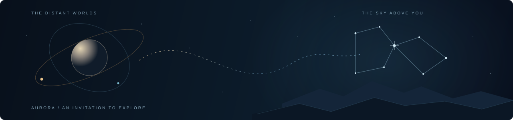

<p align="center">
  
</p>

<p align="center">
  <strong>一份关于宇宙、航天与仰望的交互作品。</strong><br>
  从遥远的行星与探测器，回到你所在的这一片夜空。
</p>

<p align="center">
  <a href="https://aurora.par73e.cn/aurora/"></a>
  <a href="#关于作品"></a>
</p>

<p align="center">
  <a href="#两种观看宇宙的方式">探索路径</a> ·
  <a href="#开始探索">体验说明</a> ·
  <a href="#数据与来源">资料来源</a> ·
  <a href="#本地运行">本地运行</a>
</p>

<br>

## 关于作品

宇宙既在遥远的地方，也在每一次抬头的时候。

AURORA 将航天探索与本地天文观测放进同一座数字观测站。你可以在三维空间中认识天体与探索任务，也可以回到自己的地点和时间，寻找今晚值得停留的天空。

作品以连续的空间转场、克制的光线和清晰的资料呈现，连接宏大的尺度与具体的观察。浏览从好奇心开始，路线由你决定。

<p align="center">
  
</p>

## 两种观看宇宙的方式

<table>
  <tr>
    <td width="50%" valign="top">
      <sub>01 / DEEP SPACE</sub>
      <h3>向远方，追寻探索的足迹</h3>
      <p>从太阳系出发，走近行星，沿着航天任务留下的路径，理解我们如何认识这些遥远的世界。</p>
      <p>转动视角，选择一个吸引你的目的地。</p>
      <a href="https://aurora.par73e.cn/aurora/#solar-system">深空探索 ↗</a>
    </td>
    <td width="50%" valign="top">
      <sub>02 / YOUR NIGHT SKY</sub>
      <h3>向头顶，寻找今晚的星空</h3>
      <p>让天空对应到你的地点与时间。结合天气、月光和天体位置，为一次真实的仰望找到方向。</p>
      <p>选好观测地点，把目光交给今晚。</p>
      <a href="https://aurora.par73e.cn/aurora/#astronomy">天文观测 ↗</a>
    </td>
  </tr>
</table>

## 开始探索

打开 [AURORA](https://aurora.par73e.cn/aurora/)，在首页选择一条路径。你可以自由浏览，也可以带着一个想了解的天体、一段任务故事，或一个关于今晚的问题进入。

作品以支持 WebGL 的电脑浏览器为主要体验场景，使用鼠标旋转、缩放和选择目标。观测地点可以手动设置，也可以使用浏览器定位；无需注册。

## 数据与来源

画面之外，资料同样值得被看见。AURORA 保留来源、历元、覆盖时间和更新状态，帮助你区分轨道推算、任务快照、天气预报与历史示意。

<details>
<summary>查看数据来源与使用说明</summary>

| 来源 | 在产品中的用途 |
| --- | --- |
| CelesTrak、Launch Library 2 | 地球航天器轨道根数、发射计划与任务状态 |
| JPL Horizons | 月球、火星与深空探测器的轨道快照和星历 |
| Open-Meteo、高德 Web 服务 | 天气、空气质量、地点搜索与地名解析 |
| NASA / GSFC、USNO、IMO、IAU MDC、JPL | 日月食、月球周期、季节、流星雨及其他天象资料 |
| NASA APOD、NASA Image Library、ESA / ESO 等 | 天文影像与图片资料 |
| NASA Black Marble / VIIRS | 年度夜间辐射与光污染环境参考 |

航天器位置由轨道模型推算；天气属于预报，SQM 与 Bortle 光污染等级属于估算。请结合页面标注的来源与数据时间阅读。外部资料、图像和贴图遵循各自的署名与使用条件。

</details>

## 本地运行

<details>
<summary>开发者：展开安装、配置与构建步骤</summary>

### 环境与技术

前端使用 Vue 3、TypeScript、Three.js 与 Vite；天文和轨道计算使用 astronomy-engine、satellite.js 与 Web Worker。后端使用 Go、chi 与 PostgreSQL，部署时可增加独立的 Redis 响应缓存网关。

准备 Node.js、pnpm、Go 1.26 或更高版本，以及 PostgreSQL。前端测试直接加载 TypeScript，本仓库已在 Node.js 26.5.0 下验证。本地开发还需能访问相关外部数据源。

### 1. 准备独立的开发数据库

在项目根目录执行以下命令；确认 `aurora_dev` 是你要新建的开发库：

```sh
createdb aurora_dev
cd backend
cp .env.example .env
```

在 `backend/.env` 中设置端口和连接串，将 `YOUR_LOCAL_USER` 替换为本机 PostgreSQL 用户，并按本机认证方式填写连接信息：

```dotenv
PORT=8080
DATABASE_URL=postgres://YOUR_LOCAL_USER@127.0.0.1:5432/aurora_dev?sslmode=disable
```

地点搜索与解析使用 `AMAP_WEB_KEY`，NASA APOD 使用 `NASA_API_KEY`。光污染需要准备本地栅格并设置 `LIGHT_POLLUTION_DATA_PATH`，见 [VIIRS 数据说明](backend/data/light-pollution/README.md)。密钥留在后端环境中，`.env` 不提交到 Git。

### 2. 启动后端

在 `backend/` 中运行：

```sh
go run ./cmd/api
```

服务启动会自动执行未应用的数据库迁移，并在后台同步资料。状态入口为 `http://localhost:8080/api/health`；首次获取资料需要等待上游响应。请使用开发库运行。

### 3. 启动前端

另开终端，在项目根目录执行：

```sh
cd frontend
pnpm install --frozen-lockfile
pnpm dev --host 127.0.0.1
```

打开 **http://localhost:5173/aurora/**。开发服务器默认把 `/api` 代理到 `http://localhost:8080`；后端端口不同时，可用 `VITE_API_PROXY` 指定目标。

Redis 是部署时的可选加速层，本地启动前后端无需配置 Redis。各功能仍需要对应的数据、密钥与网络条件。

### 4. 测试与构建

```sh
# 项目根目录
cd frontend
pnpm test
pnpm build

cd ../backend
go test ./...
go build ./cmd/api
```

数据库集成与真实上游测试需另行显式配置，普通测试通过不代表这些链路已完成验收。

### 继续阅读

- [后端入门与数据库测试](backend/README.md)
- [三维性能与资源策略](docs/scene-performance.md)
- [Redis 与浏览器缓存说明](docs/redis-cache.md)
- [缓存实点验证记录与边界](docs/cache-validation-20261105.md)

</details>

<br>

---

<p align="center">
  <strong>AURORA · 从太阳系到你头顶的夜空</strong><br>
  <sub>A Universe of Rockets, Orbits, Research and Astronomy</sub><br><br>
  <a href="https://aurora.par73e.cn/aurora/">进入作品 ↗</a> ·
  <a href="https://github.com/par73e/AURORA/issues">留下建议</a> ·
  <a href="LICENSE">MIT License</a><br>
  <sub>代码采用 MIT 许可；第三方资料与素材遵循各自的许可。</sub>
</p>
