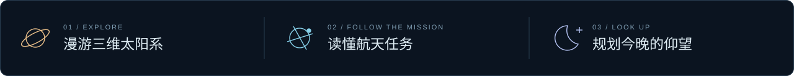
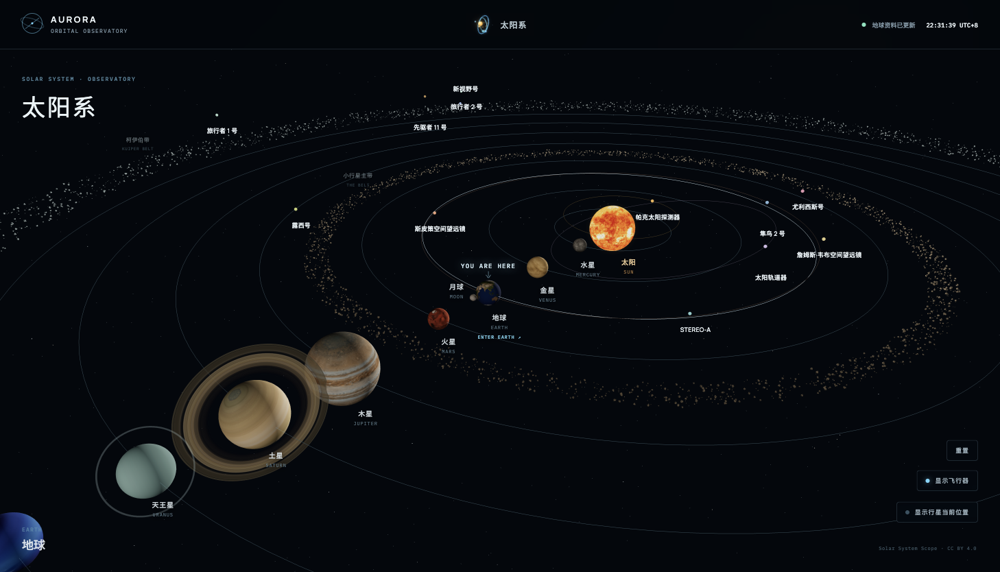
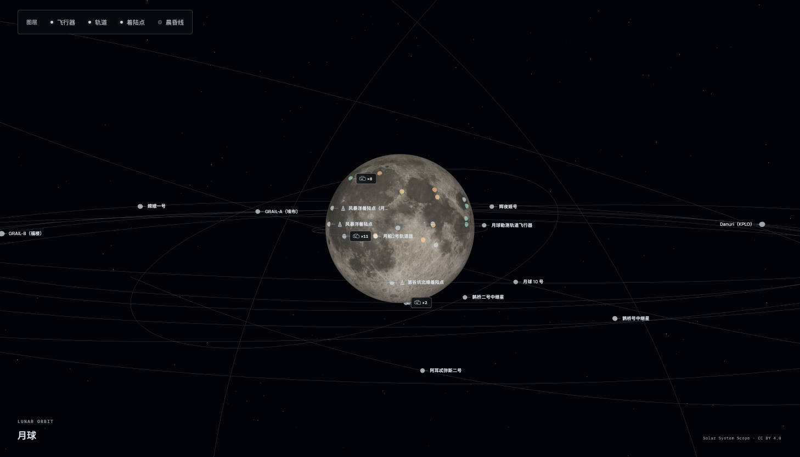
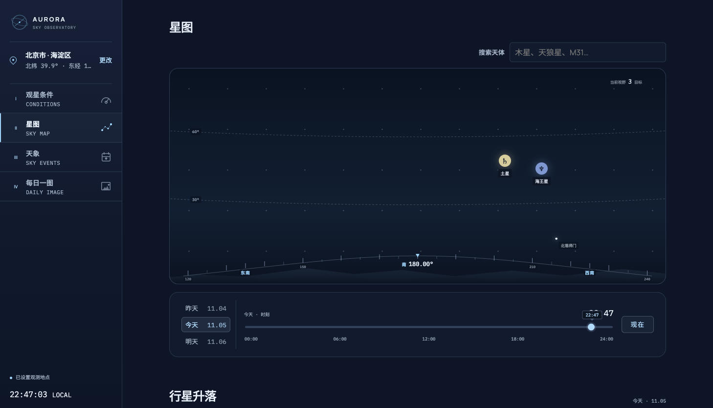
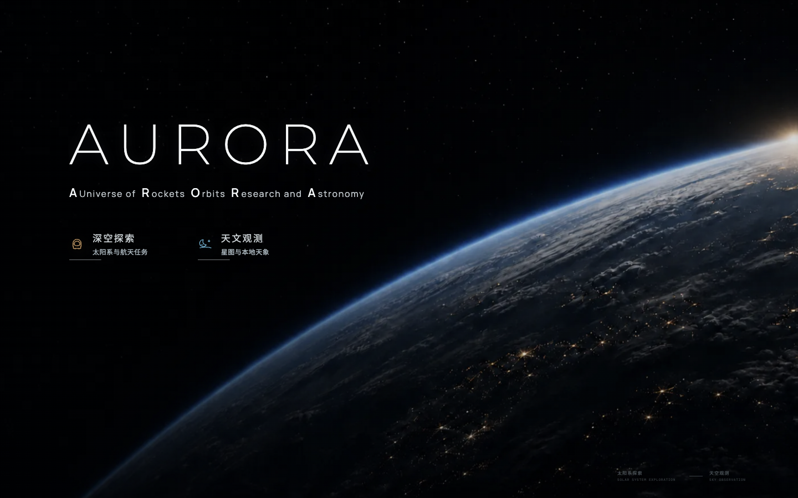

<p align="center">
  
</p>

<p align="center">
  <strong>一边探索远方的宇宙，一边准备今晚的仰望。</strong><br>
  三维太阳系 · 航天任务 · 本地星图 · 今夜观测计划
</p>

<p align="center">
  <a href="https://aurora.par73e.cn/aurora/"></a>
  <a href="#界面预览"></a>
  <a href="#本地运行"></a>
</p>

<p align="center">
  <a href="https://aurora.par73e.cn/aurora/"></a>
  <a href="#开始你的旅程"></a>
  <a href="LICENSE"></a>
</p>

<p align="center">
  <a href="#两种探索方式">产品功能</a> ·
  <a href="#界面预览">真实界面</a> ·
  <a href="#数据与来源">数据来源</a> ·
  <a href="https://github.com/par73e/AURORA/issues">反馈与建议</a>
</p>

<br>

AURORA 是一座可以在浏览器里进入的宇宙观测站。从太阳系出发，走近地球、月球与火星，追寻航天器的探索旅程；回到自己的观测地点，查看天气、月光与天体位置，把好奇心变成一晚的观测计划。

<p align="center">
  
</p>

## 界面预览

<a href="https://aurora.par73e.cn/aurora/#solar-system">
  
</a>

<p align="center"><sub>从太阳系总览开始，沿着行星与航天任务继续探索。点击图片进入体验。</sub></p>

<table>
  <tr>
    <td width="50%" valign="top">
      <a href="https://aurora.par73e.cn/aurora/#moon"></a>
      <h3>走近一个世界</h3>
      <p>查看月球与火星的轨道飞行器、着陆点和任务档案，让探索历史回到它发生的地方。</p>
    </td>
    <td width="50%" valign="top">
      <a href="https://aurora.par73e.cn/aurora/#astronomy-sky"></a>
      <h3>找到今晚的方向</h3>
      <p>按观测地点与时间查看天空，搜索目标、追踪星轨，把想看的天体放回真实方位。</p>
    </td>
  </tr>
</table>

<details>
<summary>再看一眼：产品封面与观星条件</summary>




</details>

<sub>以上为 2026-11-05 正式页面截图；观测示例使用北京公开坐标，时间、天气与任务资料会随实际数据变化。截图与素材来源见<a href="docs/showcase/README.md">展示素材说明</a>。</sub>

## 两种探索方式

<table>
  <tr>
    <td width="50%" valign="top">
      <h3>🪐 深空探索</h3>
      <p><strong>从认识一颗行星，到读懂一次任务。</strong></p>
      <ul>
        <li>漫游太阳与八大行星，在示意布局和真实位置模式之间切换。</li>
        <li>搜索地球航天器，聚焦目标，查看轨道、任务资料与近期发射。</li>
        <li>走近月球与火星，浏览飞行器、着陆点和表面任务。</li>
        <li>沿深空探测器的路径，了解目的地、任务阶段与探索背景。</li>
      </ul>
      <a href="https://aurora.par73e.cn/aurora/#solar-system">进入深空探索 ↗</a>
    </td>
    <td width="50%" valign="top">
      <h3>☾ 天文观测</h3>
      <p><strong>从“今晚能看吗”，到“几点朝哪里看”。</strong></p>
      <ul>
        <li>设置地点，结合天气、月光、观测评分与推荐窗口判断条件。</li>
        <li>用第一视角星图查找目标，预览昨天、今天与明天的天空。</li>
        <li>查阅天象日历，了解日月食、流星雨与行星事件的本地可见性。</li>
        <li>复制含地点和时刻的今夜计划，或在天文图片墙继续发现宇宙。</li>
      </ul>
      <a href="https://aurora.par73e.cn/aurora/#astronomy">进入天文观测 ↗</a>
    </td>
  </tr>
</table>

## 开始你的旅程

| 想自由探索 | 想准备今晚的观测 |
| --- | --- |
| **01** 进入深空探索，转动太阳系 | **01** 进入天文观测，设置观测地点 |
| **02** 选择地球，搜索国际空间站等目标 | **02** 查看天气、月光和推荐时间窗口 |
| **03** 前往月球或火星，展开任务与着陆点 | **03** 打开星图，聚焦感兴趣的天体 |
| **04** 返回总览，寻找下一个目的地 | **04** 查阅天象，复制今夜计划文本 |

推荐使用支持 WebGL 的电脑浏览器，通过鼠标旋转、缩放和点击目标。定位可使用浏览器授权，也可搜索地点或手动输入经纬度。

近期访问的数据会短时复用，减少重复加载；三维场景采用按需加载贴图、后台轨道计算与动态分辨率，帮助控制浏览负担。浏览器数据缓存随刷新或关闭标签页释放。

## 数据与来源

画面之外，资料同样值得被看见。AURORA 保留来源、历元、覆盖时间和更新状态，帮助你区分轨道推算、任务快照、天气预报与历史示意。

<details>
<summary>查看数据来源与使用说明</summary>

| 来源 | 在产品中的用途 |
| --- | --- |
| CelesTrak、Launch Library 2 | 地球航天器轨道根数、发射计划与任务状态 |
| JPL Horizons | 月球、火星与深空探测器的轨道快照和星历 |
| Open-Meteo、高德 Web 服务 | 天气、空气质量、地点搜索与地名解析 |
| NASA / GSFC、USNO、IMO、IAU MDC、JPL | 日月食、月球周期、季节、流星雨及其他天象资料 |
| NASA APOD、NASA Image Library、ESA / ESO 等 | 天文影像与图片资料 |
| NASA Black Marble / VIIRS | 年度夜间辐射与光污染环境参考 |

航天器位置由轨道模型推算；天气属于预报，SQM 与 Bortle 光污染等级属于估算。请结合页面标注的来源与数据时间阅读。外部资料、图像和贴图遵循各自的署名与使用条件。

</details>

## 本地运行

<details>
<summary>开发者：展开安装、配置与构建步骤</summary>

### 环境与技术

前端使用 Vue 3、TypeScript、Three.js 与 Vite；天文和轨道计算使用 astronomy-engine、satellite.js 与 Web Worker。后端使用 Go、chi 与 PostgreSQL，部署时可增加独立的 Redis 响应缓存网关。

准备 Node.js、pnpm、Go 1.26 或更高版本，以及 PostgreSQL。前端测试直接加载 TypeScript，本仓库已在 Node.js 26.5.0 下验证。本地开发还需能访问相关外部数据源。

### 1. 准备独立的开发数据库

在项目根目录执行以下命令；确认 `aurora_dev` 是你要新建的开发库：

```sh
createdb aurora_dev
cd backend
cp .env.example .env
```

在 `backend/.env` 中设置端口和连接串，将 `YOUR_LOCAL_USER` 替换为本机 PostgreSQL 用户，并按本机认证方式填写连接信息：

```dotenv
PORT=8080
DATABASE_URL=postgres://YOUR_LOCAL_USER@127.0.0.1:5432/aurora_dev?sslmode=disable
```

地点搜索与解析使用 `AMAP_WEB_KEY`，NASA APOD 使用 `NASA_API_KEY`。光污染需要准备本地栅格并设置 `LIGHT_POLLUTION_DATA_PATH`，见 [VIIRS 数据说明](backend/data/light-pollution/README.md)。密钥留在后端环境中，`.env` 不提交到 Git。

### 2. 启动后端

在 `backend/` 中运行：

```sh
go run ./cmd/api
```

服务启动会自动执行未应用的数据库迁移，并在后台同步资料。状态入口为 `http://localhost:8080/api/health`；首次获取资料需要等待上游响应。请使用开发库运行。

### 3. 启动前端

另开终端，在项目根目录执行：

```sh
cd frontend
pnpm install --frozen-lockfile
pnpm dev --host 127.0.0.1
```

打开 **http://localhost:5173/aurora/**。开发服务器默认把 `/api` 代理到 `http://localhost:8080`；后端端口不同时，可用 `VITE_API_PROXY` 指定目标。

Redis 是部署时的可选加速层，本地启动前后端无需配置 Redis。各功能仍需要对应的数据、密钥与网络条件。

### 4. 测试与构建

```sh
# 项目根目录
cd frontend
pnpm test
pnpm build

cd ../backend
go test ./...
go build ./cmd/api
```

数据库集成与真实上游测试需另行显式配置，普通测试通过不代表这些链路已完成验收。

### 继续阅读

- [后端入门与数据库测试](backend/README.md)
- [三维性能与资源策略](docs/scene-performance.md)
- [Redis 与浏览器缓存说明](docs/redis-cache.md)
- [缓存实点验证记录与边界](docs/cache-validation-20261105.md)

</details>

<br>

---

<p align="center">
  <strong>AURORA · 从太阳系到你头顶的夜空</strong><br>
  <sub>Vue 3 · Three.js · TypeScript · Go · PostgreSQL · Redis</sub><br><br>
  <a href="https://aurora.par73e.cn/aurora/">开始探索 ↗</a> ·
  <a href="https://github.com/par73e/AURORA/issues">提出建议</a> ·
  <a href="LICENSE">MIT License</a><br>
  <sub>代码采用 MIT 许可；第三方资料与素材遵循各自的许可。</sub>
</p>
