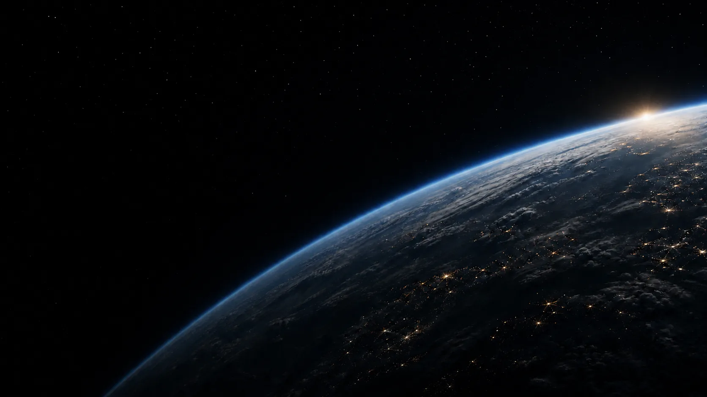

<div align="center">


# AURORA

### 从太阳系到你头顶的夜空

在三维宇宙中追寻航天任务，也为今晚的仰望找到时间与方向。

[探索宇宙](#探索宇宙) · [计划今晚的观测](#计划今晚的观测) · [开始体验](#开始体验) · [本地运行](#本地运行)

</div>



AURORA 是一个面向航天与天文爱好者的交互网站。你可以从太阳系一路走近地球、月球和火星，了解航天器正在经历的旅程；也可以回到自己的观测地点，查看天气、星图和天象，安排一晚的观测。

**深空探索**与**天文观测**是首页的两个入口。无需注册，使用浏览器即可开始。

## 探索宇宙

### 从太阳系出发，走近每一个目的地

转动视角、拉近行星，沿着连续的镜头转场进入天体近景。你既可以用示意布局认识太阳系，也可以切换到真实位置模式，理解天体之间的空间关系。

- **看天体**：浏览太阳、八大行星与月球，观察表面、光照、云层和光环，阅读天体档案。
- **找任务**：查看深空探测器的目的地、路径与任务阶段，把一个名字放回它的探索背景。
- **读细节**：点击任务和表面标记，展开资料；近距离查看密集区域的标签与着陆点。

### 看见地球周围的航天活动

在三维地球上寻找航天器，查看它的轨道与任务资料。也可以从目录搜索熟悉的名字，再把目标放回地球周围的空间中。

| 你想了解的事 | 在 AURORA 中可以做什么 |
| --- | --- |
| 国际空间站在哪里？ | 搜索并聚焦目标，查看根据轨道根数推算的位置与轨迹 |
| 某颗卫星承担什么任务？ | 按关键词和运营方筛选目录，阅读航天器资料 |
| 火箭从哪里出发？ | 在地球上查看发射场的位置与设施介绍 |
| 接下来有哪些发射？ | 浏览近期发射计划、任务状态和资料来源 |

### 继续前往月球、火星与更远的世界

月球和火星拥有各自的轨道飞行器、着陆点与任务目录。进入其他行星，可以沿着代表性探测任务回看人类的探索足迹；土卫六还提供惠更斯号的独立任务视图。

任务资料会区分轨道快照、历史任务和在途示意，并展示相应的数据时间，帮助你理解画面所表达的阶段。

## 计划今晚的观测

### 今晚适不适合出门？

设置观测地点，把天气、月光和夜空背景放在一起看。

- 查看当前天气以及今天、明天的逐小时预报，结合云量、能见度、降水和风速判断条件。
- 阅读今夜与明夜的观测评分、推荐窗口和目标建议。
- 查看月相、月出月落与日出日落，了解月光和天色的影响。
- 查看基于年度卫星数据的光污染参考，了解地点的长期夜空背景与估算的 SQM、Bortle 等级。
- 生成并复制含地点、时间与目标的今夜观测计划文本。

### 该在什么时候，朝哪个方向看？

打开第一视角星图，让天体的位置对应到你的观测地点和时间。搜索恒星或行星，查看它与地平线的关系，再沿轨迹找到适合观察的时刻。

星图支持昨天、今天、明天的天空预览与时间调节；从观测建议跳转时，也会带上对应的目标与时刻。

### 有什么值得等待？

**天象日历**汇集月球周期、季节节点、日月食、流星雨与行星相关事件。展开事件，可以查看时间、资料来源与地点可见性；日食详情还可提供基于 NASA 数据计算的本地接触时刻与食分。

**宇宙图像**通过每日天文图片和专题图片墙，带你认识望远镜与探测器眼中的宇宙。图片保留说明、发布日期、署名和原始来源，方便继续阅读。

## 开始体验

首次使用，可以任选一条路线：

| 想自由探索 | 想准备今晚的观测 |
| --- | --- |
| 进入「深空探索」，转动太阳系 | 进入「天文观测」，设置观测地点 |
| 选择地球，搜索一个熟悉的航天器 | 先看观测条件与推荐时间窗口 |
| 前往月球或火星，展开任务与着陆点 | 打开星图，聚焦感兴趣的目标 |
| 返回总览，继续寻找下一个目的地 | 查阅天象，并复制今夜计划文本 |

推荐在支持 WebGL 的电脑浏览器中体验三维场景，使用鼠标旋转、缩放和点击目标。定位可使用浏览器授权，也可搜索地点或手动输入经纬度。

近期访问的数据会短时复用，减少重复加载；三维场景还采用按需加载贴图、后台轨道计算与动态分辨率，帮助控制浏览时的负担。浏览器中的数据缓存随刷新或关闭标签页释放。

## 每一份资料，都有来处

AURORA 将可视化与资料来源连接起来，保留数据时间和更新状态，方便从画面回到依据。

| 来源 | 在产品中的用途 |
| --- | --- |
| CelesTrak、Launch Library 2 | 地球航天器轨道根数、发射计划与任务状态 |
| JPL Horizons | 月球、火星与深空探测器的轨道快照和星历 |
| Open-Meteo、高德 Web 服务 | 天气、空气质量、地点搜索与地名解析 |
| NASA / GSFC、USNO、IMO、IAU MDC、JPL | 日月食、月球周期、季节、流星雨及其他天象资料 |
| NASA APOD、NASA Image Library、ESA / ESO 等 | 天文影像与图片资料 |
| NASA Black Marble / VIIRS | 年度夜间辐射与光污染环境参考 |

航天器位置由轨道模型推算；天气属于预报，光污染等级属于估算。查看时请结合页面标注的来源、历元、覆盖时间与更新状态。图片及外部资料的权利归各自作者和机构所有，具体使用信息以原始来源为准。

## 本地运行

<details>
<summary>开发者：展开安装、配置与构建步骤</summary>

### 环境与技术

前端使用 Vue 3、TypeScript、Three.js 与 Vite；天文和轨道计算使用 astronomy-engine、satellite.js 与 Web Worker。后端使用 Go、chi 与 PostgreSQL，部署时可增加独立的 Redis 响应缓存网关。

准备 Node.js、pnpm、Go 1.26 或更高版本，以及 PostgreSQL。前端测试直接加载 TypeScript，本仓库已在 Node.js 26.5.0 下验证。本地开发还需能访问相关外部数据源。

### 1. 准备独立的开发数据库

在项目根目录执行以下命令；确认 `aurora_dev` 是你要新建的开发库：

```sh
createdb aurora_dev
cd backend
cp .env.example .env
```

在 `backend/.env` 中设置端口和连接串，将 `YOUR_LOCAL_USER` 替换为本机 PostgreSQL 用户，并按本机认证方式填写连接信息：

```dotenv
PORT=8080
DATABASE_URL=postgres://YOUR_LOCAL_USER@127.0.0.1:5432/aurora_dev?sslmode=disable
```

地点搜索与解析使用 `AMAP_WEB_KEY`，NASA APOD 使用 `NASA_API_KEY`。光污染需要准备本地栅格并设置 `LIGHT_POLLUTION_DATA_PATH`，见 [VIIRS 数据说明](backend/data/light-pollution/README.md)。密钥留在后端环境中，`.env` 不提交到 Git。

### 2. 启动后端

在 `backend/` 中运行：

```sh
go run ./cmd/api
```

服务启动会自动执行未应用的数据库迁移，并在后台同步资料。状态入口为 `http://localhost:8080/api/health`；首次获取资料需要等待上游响应。请使用开发库运行。

### 3. 启动前端

另开终端，在项目根目录执行：

```sh
cd frontend
pnpm install --frozen-lockfile
pnpm dev --host 127.0.0.1
```

打开 **http://localhost:5173/aurora/**。开发服务器默认把 `/api` 代理到 `http://localhost:8080`；后端端口不同时，可用 `VITE_API_PROXY` 指定目标。

Redis 是部署时的可选加速层，本地启动前后端无需配置 Redis。各功能仍需要对应的数据、密钥与网络条件。

### 4. 测试与构建

```sh
# 项目根目录
cd frontend
pnpm test
pnpm build

cd ../backend
go test ./...
go build ./cmd/api
```

数据库集成与真实上游测试需另行显式配置，普通测试通过不代表这些链路已完成验收。

### 继续阅读

- [后端入门与数据库测试](backend/README.md)
- [三维性能与资源策略](docs/scene-performance.md)
- [Redis 与浏览器缓存说明](docs/redis-cache.md)
- [缓存实点验证记录与边界](docs/cache-validation-20261105.md)

</details>
